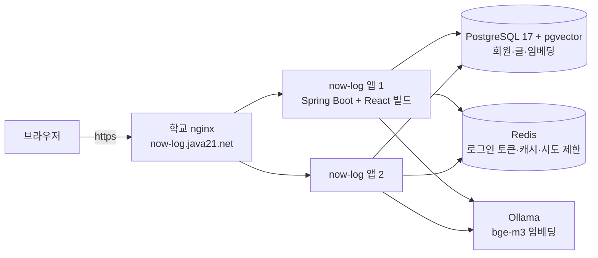
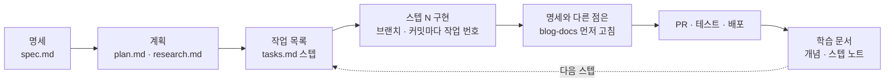

# now-log

누구나 가입해 자기 블로그(`/@주소`)를 열고, 에디터로 글을 쓰고, 다른 블로그 글을 읽고 댓글·공감·구독하는 티스토리형 멀티 블로그 서비스입니다.

**운영** → https://now-log.java21.net · **최신 릴리스** → [v1.1.0](https://github.com/blog-hjiwon203/now-log/releases/tag/v1.1.0)

> 2026-10-08 ~ 2026-10-22 개발을 마무리했습니다. 작업 163개를 모두 끝냈고, 운영 사이트는 계속 돌아갑니다. 남은 일은 [now-log README](https://github.com/blog-hjiwon203/now-log#남은-일)에 있습니다.

| 홈 | 블로그 첫 화면 |
| --- | --- |
|  |  |

## 저장소

| 저장소 | 내용 |
| --- | --- |
| [now-log](https://github.com/blog-hjiwon203/now-log) | 구현 코드(백엔드 + 프론트), GitHub Actions 배포, [릴리스](https://github.com/blog-hjiwon203/now-log/releases)와 [CHANGELOG](https://github.com/blog-hjiwon203/now-log/blob/main/CHANGELOG.md) |
| [blog-docs](https://github.com/blog-hjiwon203/blog-docs) | 명세·계획·작업 목록·API·ERD·화면 시안, 스텝별 학습 자료 |

## 주요 기능

- 회원가입·로그인(이메일 인증, 카카오·구글), 블로그 개설과 꾸미기
- Tiptap 에디터로 글 작성(이미지, 임시 저장, 예약 발행, 공개 범위), 카테고리·태그
- 댓글·답글, 공감, 북마크, 구독과 피드, 알림, 인기 글 순위
- 검색과 bge-m3 임베딩 기반 의미 검색·비슷한 글 추천
- 블로그 관리 화면(방문 통계, 차단·금칙어)과 서비스 관리자(신고·정지·공지)

## 구성

- React 빌드 결과를 jar 안 `static/`에 넣어 **서버 하나**로 배포합니다. 화면은 `/@주소/...`, API는 `/api/...`입니다.
- 모두 도커 컨테이너이고, 서버 밖으로는 앱 포트만 엽니다. 앱은 두 대이고 nginx가 나눠 보냅니다.
- **배포**: main에 병합하면 GitHub Actions가 테스트(Testcontainers) → 도커 이미지 빌드 → SSH로 서버에 보내 **앱을 한 대씩** 바꿉니다. 바꾼 앱의 준비 확인(`/actuator/health/readiness`)이 UP이 되어야 다음 앱으로 넘어가고, 실패하면 옛 이미지로 되돌립니다. 배포하는 동안 보낸 요청 362번이 모두 200이었습니다.
- **코드 품질**: 같은 병합 때 다른 워크플로가 커버리지(JaCoCo, Vitest)와 함께 SonarQube 분석을 돌립니다. 배포와 따로 돌아서 분석이 실패해도 배포는 막히지 않습니다.

## 기술

- **백엔드** Java 21, Spring Boot 4.1(Web MVC, Security, Data JPA, Flyway), Maven
- **프론트** React, TypeScript, Vite, Tiptap
- **데이터** PostgreSQL 17 + pgvector, Redis, Ollama(bge-m3)
- **테스트** JUnit 5, MockMvc, Testcontainers, ArchUnit, Vitest
- **배포·품질** Docker, GitHub Actions, SonarQube, JaCoCo

## 설계에서 신경 쓴 점

- **볼 수 없는 글은 로그인 여부와 상관없이 404.** 비공개 글이 "있다는 사실"도 드러내지 않고, 권한은 모두 서버에서 검사합니다.
- **블로그 주소는 `/@주소` 경로**이고, API는 `X-Blog-Address` 헤더로 어느 블로그인지 정합니다.
- **임베딩은 글 저장이 커밋된 뒤 비동기로.** `@TransactionalEventListener` + `@Async`라서 저장 응답이 모델 계산을 기다리지 않고, 저장이 롤백되면 임베딩도 만들지 않습니다.
- **인기 글**은 최근 1시간의 조회×1 + 공감×3 + 댓글×5로 매기고, 계산 결과는 Redis에 5분 캐시합니다.
- **로그인**은 HttpOnly 쿠키에 담은 JWT. Refresh 토큰은 Redis에 두고 로그아웃하면 지웁니다.
- **앱이 두 대여도 한 번만.** 예약 발행은 글 행을 잠그고 바뀐 행이 있는 쪽만 후속 처리를 하고, 새벽 통계 모으기는 DB advisory lock을 잡은 앱 하나만 합니다.

## 진행 방식

- [Spec Kit](https://github.com/github/spec-kit) 흐름으로 명세 → 계획 → 작업 목록을 먼저 만들고, 작업 목록의 **스텝 단위**로 구현했습니다.
- 문서(blog-docs)와 코드(now-log)를 저장소로 나눴습니다. 구현하다 명세와 달라져야 하면 코드보다 **문서를 먼저** 고칩니다.
- 스텝마다 그 스텝에서 처음 쓴 개념을 처음부터 정리한 [학습 문서](https://github.com/blog-hjiwon203/blog-docs/tree/main/learning)를 남겼습니다. 개념 문서는 개발 환경과 배포, 데이터, 보안, 웹과 프론트, 기능 설계 다섯 주제로 묶었습니다.
- 버전은 [유의적 버전](https://semver.org/lang/ko/)을 따르고, 버전마다 바뀐 것을 [릴리스](https://github.com/blog-hjiwon203/now-log/releases)로 남깁니다.

| 버전 | 날짜 | 내용 |
| --- | --- | --- |
| v1.1.0 | 2026-10-22 | 화면 다듬기, SonarQube 프론트 지적 정리 |
| v1.0.0 | 2026-10-16 | 앱 두 대 무중단 배포, SonarQube |
| v0.4.0 | 2026-10-14 | 의미 검색, PostgreSQL + pgvector 하나로 |
| v0.3.0 | 2026-10-12 | 첫 운영 배포, 블로그 주소를 `/@주소`로 |
| v0.2.0 | 2026-10-11 | 임시저장, 구독·알림, 블로그 꾸미기, 서비스 관리 |
| v0.1.0 | 2026-10-10 | 가입 → 블로그 → 글 → 홈 → 댓글 한 바퀴 |

처음 개발은 과제 제출용 저장소 [AIP-1/blog-basic-AIGJ_01_017-blog](https://github.com/AIP-1/blog-basic-AIGJ_01_017-blog)에서 했고, 2026-10-14에 커밋 기록째 now-log로 옮겼습니다.
